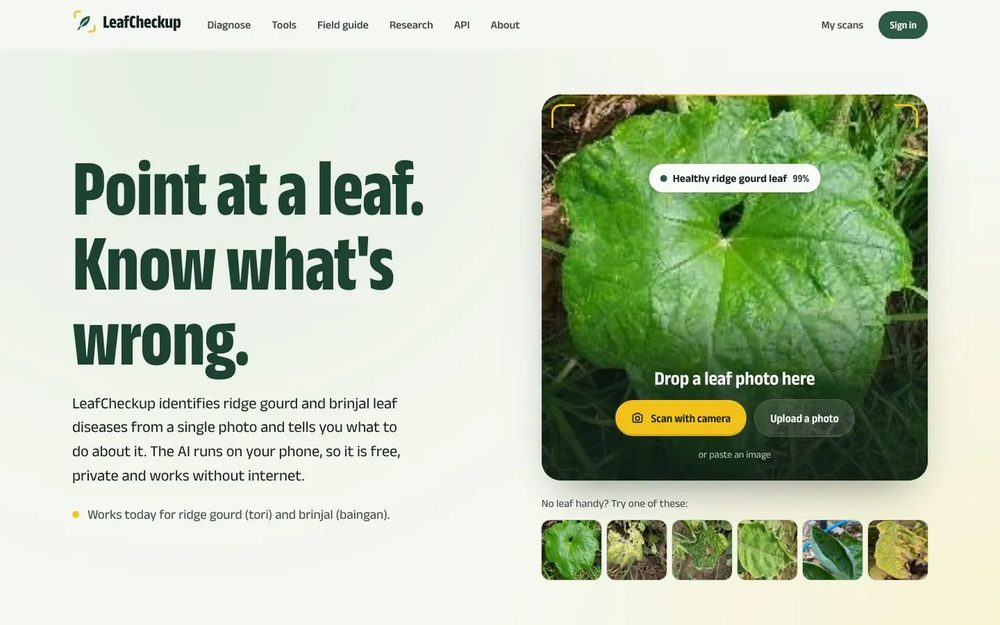
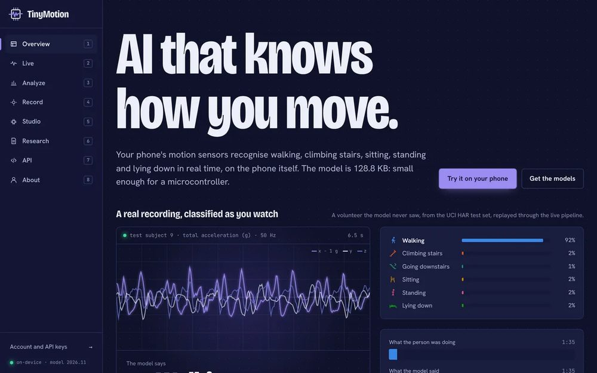

<picture>
  <source media="(prefers-color-scheme: dark)" srcset="assets/header-dark.svg">
  
</picture>

  <a href="https://pranay-agarwal.vercel.app"><b>Portfolio</b></a> &nbsp;·&nbsp;
  <a href="https://pranay-agarwal.vercel.app/resume">Résumé</a> &nbsp;·&nbsp;
  <a href="https://www.linkedin.com/in/pranay-agarwal-83b177295/">LinkedIn</a> &nbsp;·&nbsp;
  <a href="https://scholar.google.com/citations?hl=en&user=L2xx3fgAAAAJ">Google Scholar</a> &nbsp;·&nbsp;
  <a href="https://orcid.org/0009-0009-6879-4074">ORCID</a> &nbsp;·&nbsp;
  <a href="mailto:pranayagarwal2511@gmail.com">Email</a>

 

I turn research into products people can use. At MaxBrain Technologies I went from collecting leaf photos on farms near Jaipur to published datasets, Springer papers, an app on Google Play and a device design registered with the Government of India. On my own, I build models that run entirely on the device: in a phone's browser or on a microcontroller.

## Shipped

<table>
  <tr>
    <td width="50%" valign="top">
      
      <h3>LeafCheckup</h3>
      
Crop disease diagnosis from one leaf photo, running entirely in the phone's browser.

      <ul>
        <li><b>94.9%</b> accuracy on 217 unseen leaves, leak-free split</li>
        <li><b>~120 ms</b> per photo with ONNX Runtime Web + WebAssembly</li>
        <li><b>0.993 AUROC</b> at refusing photos that aren't a supported leaf</li>
      </ul>
      
<i>PyTorch · EfficientNet-B0 · ONNX Runtime Web · Next.js · FastAPI · PostgreSQL</i>

      
<a href="https://leafcheckup.vercel.app"><b>Live</b></a> · <a href="https://github.com/agarwalpranay02/leafcheckup">Code</a> · <a href="https://pranay-agarwal.vercel.app/work#leafcheckup">Case study</a>

    </td>
    <td width="50%" valign="top">
      
      <h3>TinyMotion</h3>
      
Human activity recognition from phone motion sensors, small enough for a microcontroller.

      <ul>
        <li><b>93.4 ± 1.1%</b> on 9 unseen people (UCI HAR, 5 seeds)</li>
        <li><b>92.8%</b> with the phone held at any angle</li>
        <li><b>85.7 KB</b> INT8 model, also exported as a dependency-free C99 header</li>
      </ul>
      
<i>TensorFlow · TFLite Micro · C99 · TypeScript · Next.js</i>

      
<a href="https://tinymotion.vercel.app"><b>Live</b></a> · <a href="https://github.com/agarwalpranay02/tinymotion">Code</a> · <a href="https://pranay-agarwal.vercel.app/work#tinymotion">Case study</a>

    </td>
  </tr>
</table>

## Research

- **A Hybrid Deep Learning Approach for Automated Plant Disease Diagnosis in Indian Ridge Gourd: Dataset Creation and Real-World Application** 
  **P. Agarwal**, P. Sharma, V. Sharma · MIND 2025, Springer CCIS · First author · [Paper](https://link.springer.com/chapter/10.1007/978-3-032-31233-4_7) · [Code](https://github.com/agarwalpranay02/Hybrid-Deep-Learning-for-Plant-Disease-Diagnosis)
- **A comprehensive review and bibliometric analysis of deep learning applications in plant disease detection** 
  P. Sharma, **P. Agarwal**, A. K. Bairwa, V. Sharma · Discover Artificial Intelligence, Springer Nature, 2026 · [Paper](https://doi.org/10.1007/s44163-026-02310-z)
- **TinyML-Based Lightweight Deep Learning Model for Human Activity Recognition on Edge Devices** 
  P. Sharma, **P. Agarwal**, J. Goyal · WCAIAA 2026, Springer LNNS · To appear

**Registered design** · No. 476293-001, The Patent Office, Government of India: an IoT device for real-time collection and augmentation of plant samples. 
**Open datasets** · [Ridge gourd leaves, 9,000 images](https://ieee-dataport.org/documents/preprocessed-indian-ridge-gourd-leaf-image-dataset-healthy-and-diseased-leaf-minor) (IEEE DataPort) · [Brinjal leaves, 13,600 images](https://data.mendeley.com/datasets/c39p3k87g2) (Mendeley Data)

## Experience

**AI/ML Engineer, MaxBrain Technologies** · Jan 2026 – present (Research Intern from Jul 2025) 
Bibliometric review of 1,081 papers, two public field datasets, a DenseNet121 + XGBoost model at 92.0%, and [Fasal Saathi](https://play.google.com/store/apps/details?id=com.param.finddiseaseai), an Android app on Google Play.

**Software Engineering Intern, Starlight Data Solutions** · May – Jul 2025 
An automated firmware tracking system: Python scrapers, a Flask API, MongoDB and Elasticsearch.

## Toolbox

   
  

On-device AI: ONNX Runtime Web · WebAssembly · WebGPU · TensorFlow Lite (INT8) · TFLite Micro

 

B.Tech Computer Science, BIT Mesra · Oracle Certified Professional Featured researcher, Springer Nature India Research Tour 2025

